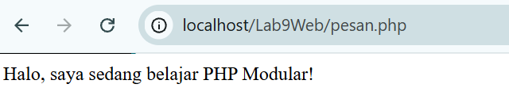
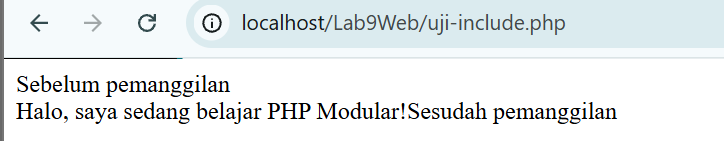
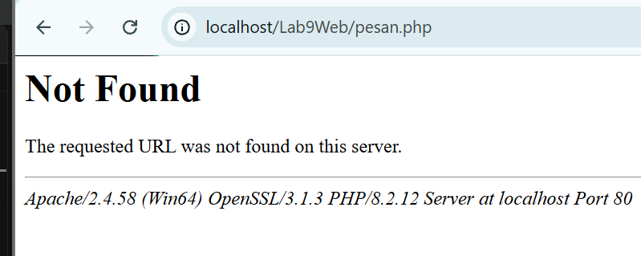
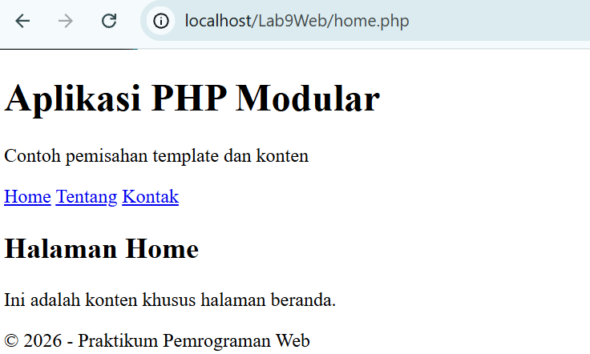
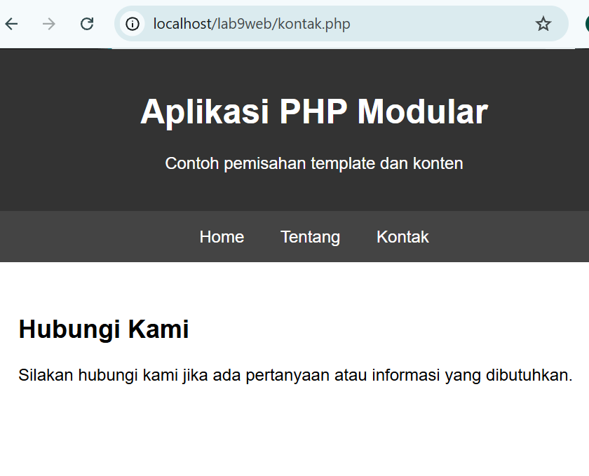

# Lab9web
# LAPORAN PRAKTIKUM 9
# PHP MODULAR

## 1. Identitas Praktikan

- **Nama:** Isnaini
- **NIM:** 312510380
- **Mata Kuliah:** Pemrograman Web

## 2. Tujuan Praktikum

1. Memahami konsep modularisasi pada PHP.
2. Memahami penggunaan perintah `include` dan `require`.
3. Mengetahui perbedaan penggunaan `include` dan `require`.
4. Membuat website sederhana menggunakan beberapa file PHP.
5. Memahami penggunaan file bersama dalam beberapa halaman website.

## 3. Alat dan Bahan

- Laptop atau komputer.
- XAMPP.
- Visual Studio Code.
- Web browser.
- PHP.

## 4. Pelaksanaan Praktikum

### A. Membuat File pesan.php

Langkah pertama adalah membuat folder project `Lab9Web` di dalam folder `htdocs`. Selanjutnya dibuat file `pesan.php` yang berisi pesan sederhana untuk menguji pemanggilan file PHP.

File tersebut kemudian dijalankan melalui browser menggunakan alamat localhost.

**Hasil Pengujian:**

### B. Pengujian Include

Selanjutnya dibuat file `uji-include.php` untuk memanggil file `pesan.php` menggunakan perintah `include`.

Pengujian dilakukan untuk melihat apakah file lain dapat dipanggil dan ditampilkan di dalam program.

Hasil yang muncul adalah:
- Sebelum pemanggilan.
- Halo, saya sedang belajar PHP Modular!
- Sesudah pemanggilan.

**Hasil Pengujian:**

### C. Pengujian Require

Setelah pengujian include, dilakukan pengujian menggunakan perintah `require`.

Pada tahap ini nama file yang dipanggil diubah untuk menguji apa yang terjadi ketika file tidak ditemukan.

Hasil pengujian menunjukkan bahwa program mengalami fatal error ketika file yang dibutuhkan tidak ditemukan. Tulisan sebelum pemanggilan masih ditampilkan, sedangkan tulisan sesudah pemanggilan tidak ditampilkan.

**Hasil Pengujian:**

### D. Membuat Template Website

Setelah mempelajari pemanggilan file PHP, praktikum dilanjutkan dengan membuat template website modular.

File yang digunakan dalam pembuatan template adalah:

- `header.php`
- `footer.php`
- `index.php`
- `home.php`
- `about.php`
- `kontak.php`
- `style.css`

File header digunakan untuk bagian atas website dan navigasi, sedangkan footer digunakan untuk bagian bawah website.
Halaman Home dibuat sebagai halaman utama website. Halaman ini menggunakan header dan footer agar tampilannya sama dengan halaman lainnya.
Halaman About dibuat untuk menampilkan informasi tentang website. Halaman ini menggunakan template yang sama dengan halaman Home.
Halaman Kontak dibuat sebagai halaman informasi kontak. Navigasi digunakan untuk memudahkan perpindahan dari satu halaman ke halaman lainnya.
Setelah pembuatan halaman selesai, dilakukan pengujian melalui browser menggunakan localhost.
Pengujian dilakukan dengan membuka halaman Home, About, dan Kontak serta mencoba menu navigasi. Hasilnya, halaman dapat ditampilkan dan navigasi dapat digunakan untuk berpindah halaman. Tampilan setiap halaman juga memiliki header, footer, dan CSS yang konsisten.

## 6. Kesimpulan

Berdasarkan praktikum yang telah dilakukan, dapat dipahami bahwa PHP Modular membantu membagi program menjadi beberapa file agar lebih terstruktur. Penggunaan `include` dan `require` memiliki perbedaan ketika file yang dipanggil tidak ditemukan. Selain itu, penggunaan template memudahkan pembuatan website dengan beberapa halaman yang memiliki tampilan konsisten.

---

**Praktikum Pemrograman Web – Praktikum 9 PHP Modular**
